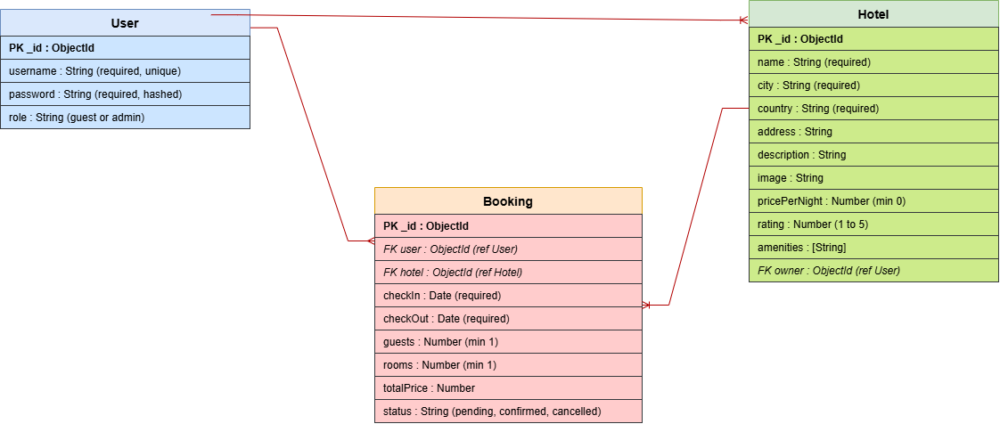

# HS Hotels

Hotel Booking Management

## Overview

HS Hotels is a hotel booking website. Anyone can browse hotels and filter them by location. Users can sign up, book a hotel and manage their own bookings. Admins can add, edit and delete hotels.

## Screenshots

## Technologies Used

- JavaScript
- Node.js
- Express
- MongoDB and Mongoose
- EJS
- CSS
- bcrypt
- express-session and connect-mongo
- method-override
- morgan
- dotenv

## Getting Started

GitHub repo: https://github.com/hamad802n/ga-project2

1. Clone the repo
2. Run `npm install`
3. Make a `.env` file with `MONGODB_URI`, `SESSION_SECRET` and `PORT`
4. Run `nodemon` and open http://localhost:3000

## User Stories

### Guest (not signed in)
- As a guest I want to browse all hotels so that I can see what places are available
- As a guest I want to filter hotels by location so that I only see hotels in the country I want
- As a guest I want to sign up for an account so that I can book a hotel

### User (signed in)
- As a user I want to sign in and sign out so that my bookings stay private to my account
- As a user I want to book a hotel by choosing check-in and check-out dates and the number of guests and rooms so that I can reserve my stay
- As a user I want to see the total price of my booking so that I know how much my stay will cost
- As a user I want to see a list of all my bookings so that I can keep track of my trips
- As a user I want to view the details of one booking so that I can check my dates and price
- As a user I want to edit a booking so that I can change my plans
- As a user I want to cancel a booking so that I can remove a trip I no longer want
- As a user I should not be able to see edit or cancel someone else's bookings

### Admin
- As an admin I want to add edit and delete hotels so that the hotel list stays up to date

## Database Design

- A **User** can have many **Bookings**.
- A **Hotel** can have many **Bookings**.
- A **Booking** belongs to one User and one Hotel.
- A **User** with the admin role can own many **Hotels**.

## Routes

| Method | Route | Description |
|---------|-------|-------------|
| GET | / | Home page with all hotels |
| GET | /?country=Bahrain | Home page filtered by location |
| GET | /auth/sign-up | Sign up form |
| POST | /auth/sign-up | Create account |
| GET | /auth/sign-in | Sign in form |
| POST | /auth/sign-in | Sign in |
| GET | /auth/sign-out | Sign out |
| GET | /hotels/new | New hotel form (admin) |
| POST | /hotels | Create hotel (admin) |
| GET | /hotels/:hotelId/edit | Edit hotel form (admin) |
| PUT | /hotels/:hotelId | Update hotel (admin) |
| DELETE | /hotels/:hotelId | Delete hotel and its bookings (admin) |
| GET | /bookings | List my bookings |
| GET | /bookings/new | New booking form |
| POST | /bookings | Create booking |
| GET | /bookings/:bookingId | View booking |
| GET | /bookings/:bookingId/edit | Edit booking form |
| PUT | /bookings/:bookingId | Update booking |
| DELETE | /bookings/:bookingId | Cancel (delete) booking |

## Features

- Sign up, sign in and sign out with hashed passwords
- New passwords must be above 6 characters
- Two roles: guest and admin
- Admins can add, edit and delete hotels
- Users can book a hotel and the total price is worked out from nights, rooms and price per night
- Users can view, edit and cancel their own bookings
- Users cannot see or change other users' bookings
- Filter hotels by location on the homepage
- Background video on the homepage

## Future Enhancements

- Hotel details page
- Photo upload for hotel images
- Admin dashboard
- Map showing where each hotel is
- Email confirmation after booking

## Credits

Mongoose distinct()  
https://mongoosejs.com/docs/api/model.html#Model.distinct()

Mongoose deleteMany()  
https://mongoosejs.com/docs/api/model.html#Model.deleteMany()

Mongoose runValidators  
https://mongoosejs.com/docs/validation.html#update-validators

Express req.query  
https://expressjs.com/en/5x/api/

JavaScript Date  
https://developer.mozilla.org/en-US/docs/Web/JavaScript/Reference/Global_Objects/Date

JavaScript toDateString()  
https://developer.mozilla.org/en-US/docs/Web/JavaScript/Reference/Global_Objects/Date/toDateString

JavaScript toISOString()  
https://developer.mozilla.org/en-US/docs/Web/JavaScript/Reference/Global_Objects/Date/toISOString

JavaScript typeof  
https://developer.mozilla.org/en-US/docs/Web/JavaScript/Reference/Operators/typeof

JavaScript ternary operator  
https://developer.mozilla.org/en-US/docs/Web/JavaScript/Reference/Operators/Conditional_operator

JavaScript logical OR  
https://developer.mozilla.org/en-US/docs/Web/JavaScript/Reference/Operators/Logical_OR

JavaScript trim()  
https://developer.mozilla.org/en-US/docs/Web/JavaScript/Reference/Global_Objects/String/trim

JavaScript length  
https://developer.mozilla.org/en-US/docs/Web/JavaScript/Reference/Global_Objects/String/length

HTML video  
https://developer.mozilla.org/en-US/docs/Web/HTML/Element/video

HTML input type date  
https://developer.mozilla.org/en-US/docs/Web/HTML/Element/input/date

CSS position  
https://developer.mozilla.org/en-US/docs/Web/CSS/position

CSS z-index  
https://developer.mozilla.org/en-US/docs/Web/CSS/z-index

CSS object-fit  
https://developer.mozilla.org/en-US/docs/Web/CSS/object-fit

CSS box-shadow  
https://developer.mozilla.org/en-US/docs/Web/CSS/box-shadow

CSS text-transform  
https://developer.mozilla.org/en-US/docs/Web/CSS/text-transform
